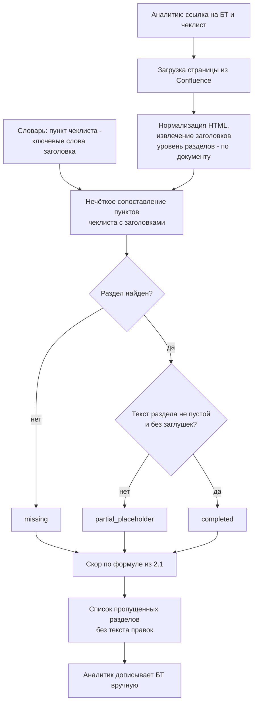
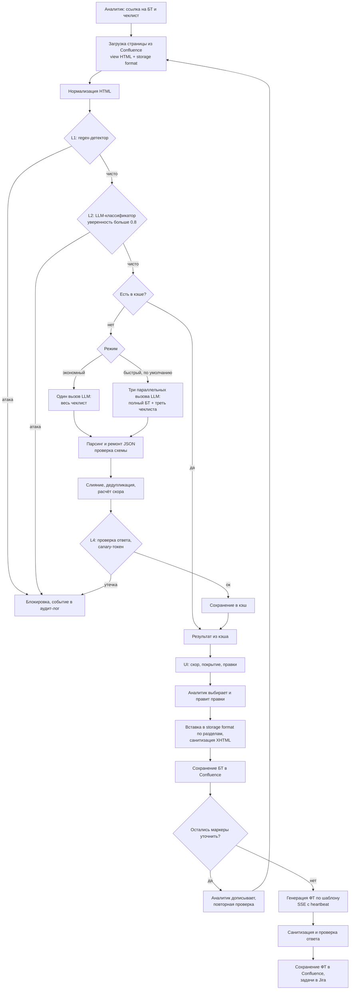
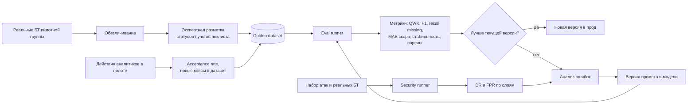
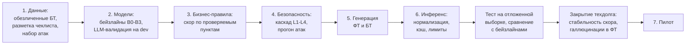
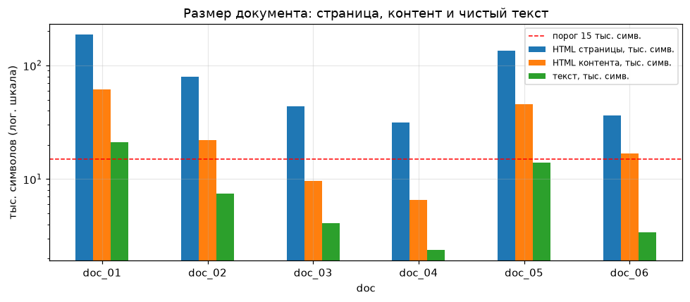
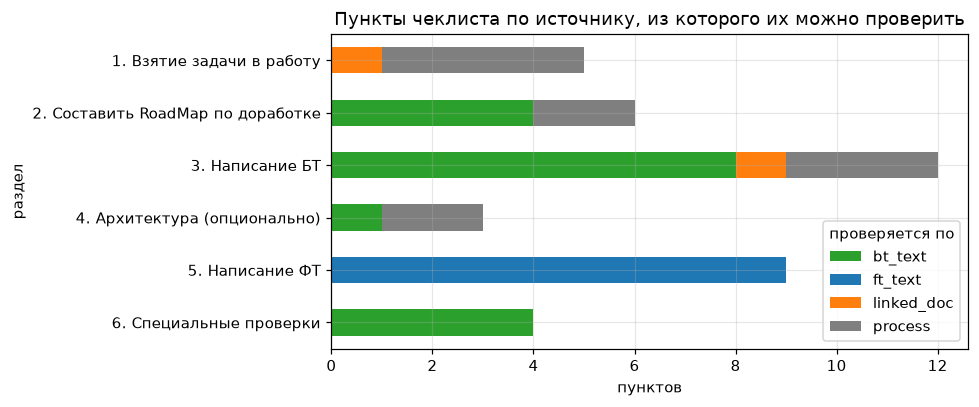
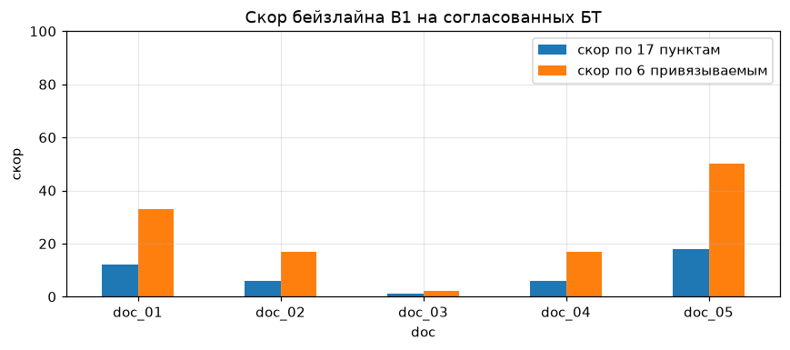
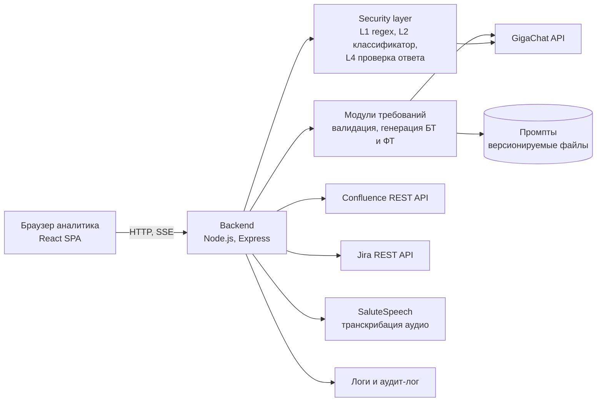

# Дизайн ML системы - ReqAssist MVP 1

ML System Design Doc LLM-ассистента системного аналитика, версия 1.0 (ДЗ 1).

Структура документа повторяет [шаблон Reliable ML](https://github.com/IrinaGoloshchapova/ml_system_design_doc_ru). Основной фокус ДЗ 1 - разделы 1 и 2; разделы 3 (пилот) и 4 (внедрение) заполнены на уровне MVP и будут детализироваться в следующих домашних заданиях.

> **О характере проекта.** ReqAssist - реальный внутренний продукт, который используется аналитиками в рабочем контуре. Название организации, внутренние адреса систем, номера задач, реальные документы и чеклисты не публикуются: в документе они заменены нейтральными формулировками и обобщёнными примерами. Замеры в разделе 2.1 взяты из внутренних прогонов и приведены без исходных данных.

## Глоссарий

| Термин | Значение |
| --- | --- |
| БТ | бизнес-требования: документ, в котором заказчик и аналитик описывают, что нужно изменить в продукте и зачем |
| ФТ | функциональные требования: документ для разработки и тестирования, детализирует БТ до уровня систем, данных и сценариев |
| Чеклист | список проверяемых критериев качества БТ (39 пунктов в 6 разделах), принятый в подразделении |
| Скор | оценка полноты БТ от 0 до 100 по чеклисту |
| Правка | предложение LLM дописать или расширить раздел БТ: заголовок, место вставки, текст-черновик |
| Storage format | XHTML-формат хранения страниц Confluence, в котором живут БТ и ФТ |
| `[уточнить: ...]` | маркер в тексте-черновике, который аналитик должен заполнить сам |

## 1. Цели и предпосылки

### 1.1. Зачем идем в разработку продукта?

#### Бизнес-цель

Сократить время аналитика на подготовку и согласование требований и снизить число дефектов требований, которые доходят до разработки.

Сейчас процесс выглядит так:

1. Аналитик проводит встречи с заказчиком и вручную собирает БТ в Confluence.
2. Перед согласованием БТ сверяются с чеклистом качества: ссылки на задачи, заинтересованные лица, источники и потребители данных, классы критичности, процессы AS IS и TO BE, интеграции, критерии приёмки, тестовые сценарии.
3. По согласованным БТ аналитик пишет ФТ по шаблону подразделения и заводит задачи в Jira.

Узкие места:

- проверка по чеклисту делается вручную и неравномерно: разные аналитики пропускают разные пункты
- пропуски находятся поздно, на ревью ФТ или в тестировании, когда исправление дороже
- перенос БТ в шаблон ФТ - механическая работа, которая занимает заметную часть времени аналитика
- в больших БТ (десятки тысяч символов, много таблиц) человеку трудно держать в голове весь документ

#### Почему ML (LLM) сделает лучше

Критерии чеклиста семантические: "описаны интеграции: названия систем, протоколы, SLA", "описаны тестовые сценарии с граничными случаями". Наличие нужного заголовка ничего не гарантирует: раздел может быть пустым, заполненным заглушкой или содержать нужную информацию под другим названием. Правила и регулярные выражения такие критерии не проверяют.

LLM позволяет:

- оценить каждый пункт чеклиста по смыслу текста, а не по структуре документа
- сразу сгенерировать черновик недостающего раздела на основе данных из самого документа
- перенести содержимое БТ в структуру шаблона ФТ с сохранением заголовков и таблиц
- извлечь требования из длинной расшифровки встречи

Аналитик остаётся владельцем документа: система предлагает, человек принимает решение.

#### Что считаем успехом итерации с точки зрения бизнеса

- аналитики пилотной группы используют валидацию БТ перед отправкой на согласование как штатный шаг
- время проверки одного БТ по чеклисту сокращается не менее чем на 30% относительно замера AS IS; считается только активная работа аналитика над проверкой, без ожидания согласований и встреч (как измеряем - раздел 3.1)
- доля предложенных правок, которые аналитик принял (целиком или с доработкой), не ниже 50%
- скор на одном и том же документе стабилен: на 5 повторных запусках без изменения документа разница между максимальным и минимальным скором не больше 5 пунктов (метрика стабильности из 2.1)
- ни одного инцидента с утечкой данных или выполнением внедрённых в документ инструкций

Целевые значения - гипотезы. Они уточняются после замера AS IS на пилоте (раздел 3).

### 1.2. Бизнес-требования и ограничения

#### Бизнес-требования

Детальные БТ к продукту ведутся во внутреннем Confluence и не публикуются; ниже сведены ключевые требования.

| № | Требование |
| --- | --- |
| БТ-1 | Загрузка БТ по ссылке на страницу Confluence без копирования текста вручную |
| БТ-2 | Проверка БТ по стандартному чеклисту подразделения или по собственному чеклисту аналитика (`.md`/`.txt`) |
| БТ-3 | Результат проверки: общий скор, статус каждого пункта чеклиста, список правок с приоритетом и местом вставки |
| БТ-4 | Применение выбранных правок в один клик с сохранением страницы в Confluence; макросы Confluence (Jira, оглавление) не ломаются |
| БТ-5 | Повторная проверка после доработки: уже применённые правки не предлагаются заново, скор не падает без изменения содержания |
| БТ-6 | Генерация ФТ по проверенным БТ в стандартном шаблоне или в шаблоне со страницы Confluence; сохранение ФТ дочерней страницей |
| БТ-7 | Создание задач в Jira со ссылками на страницы БТ и ФТ |
| БТ-8 | Генерация черновика БТ из расшифровки встречи (текст или аудио) |
| БТ-9 | Защита от prompt injection в загружаемых документах и чеклистах |

#### Бизнес-ограничения

- **Конфиденциальность.** БТ содержат внутреннюю информацию о продуктах и системах. Обрабатывать документы можно только моделью, разрешённой во внутреннем контуре (GigaChat). Внешние LLM-API недоступны.
- **Нет обучения своей модели.** Нет размеченного датасета и GPU-инфраструктуры под fine-tuning; в этой итерации работаем с LLM через API (промпты и structured output).
- **Контекстное окно.** Входы больше примерно 80 тыс. символов (БТ + шаблон + системный промпт) дают некорректный ответ модели. Нужны нормализация HTML, разбиение на части и параллельная обработка.
- **Латентность.** Генерация ответа валидации - около 60 секунд на один вызов. Ingress кластера рвёт соединения без активности дольше 60 секунд, поэтому длинные операции идут через SSE с heartbeat.
- **Строгий формат Confluence.** Сохраняемый текст должен быть валидным XHTML, иначе Confluence отклоняет запрос.
- **Человек в контуре.** Система не публикует изменения без подтверждения аналитика. Ответственность за содержание требований остаётся на аналитике.
- **Стоимость.** Каждый вызов LLM расходует токены из квоты; повторные вызовы на тех же данных нужно кэшировать.

#### Что ожидаем от итерации

- рабочий сценарий валидации БТ и генерации ФТ на реальных документах пилотной группы
- golden dataset с экспертной разметкой статусов пунктов чеклиста для офлайн-оценки
- воспроизводимая офлайн-оценка качества (скрипт + датасет + версия промпта)
- замер AS IS и TO BE по времени подготовки БТ/ФТ

#### Бизнес-процесс пилота

1. Аналитик открывает ReqAssist и вставляет ссылку на страницу БТ в Confluence.
2. Выбирает стандартный чеклист или загружает свой.
3. Получает скор, покрытие чеклиста и список правок. Отмечает нужные правки, при необходимости редактирует текст.
4. Сохраняет БТ в Confluence. Заполняет маркеры `[уточнить: ...]` и запускает повторную проверку.
5. По готовым БТ генерирует ФТ, проверяет и сохраняет их в Confluence, создаёт задачи в Jira.
6. Отмечает полезность каждой правки (принята, принята с доработкой, отклонена) - это источник онлайн-метрик.

#### Критерии успешного пилота и пути развития

Пилот успешен, если выполнены критерии из 1.1 и аналитики пилотной группы готовы продолжить использование. Дальнейшие шаги:

- расширение на другие подразделения со своими чеклистами
- офлайн-сравнение нескольких моделей и версий промптов на golden dataset
- дообучение или выбор специализированной модели, когда накопится размеченный датасет
- генерация тест-кейсов по ФТ

### 1.3. Что входит в скоуп проекта/итерации, что не входит

#### Входит в итерацию

| Блок | Что делаем | Закрывает БТ |
| --- | --- | --- |
| Валидация БТ | статус каждого пункта чеклиста, скор, правки с местом вставки | БТ-1, БТ-2, БТ-3 |
| Применение правок | вставка правок в storage format по названию раздела, санитизация XHTML, сохранение в Confluence | БТ-4 |
| Стабильность | кэш результатов, передача истории применённых правок, учёт заглушек `[уточнить]` в скоре | БТ-5 |
| Генерация ФТ | генерация по шаблону, SSE-стриминг, сохранение в Confluence, задачи в Jira | БТ-6, БТ-7 |
| Безопасность | каскад детекторов prompt injection, проверка ответа модели | БТ-9 |
| Оценка качества | golden dataset, офлайн-скрипт оценки, метрики из раздела 2.1 | - |

#### Не входит в итерацию

- генерация БТ из аудио под диктовку в браузере (БТ-8 закрывается только для текстовых расшифровок и загруженных аудиофайлов)
- fine-tuning и обучение собственных моделей
- поддержка источников, кроме Confluence (Word-файлы, другие вики)
- автоматическая публикация БТ и ФТ без подтверждения аналитиком
- генерация кода и тест-кейсов по ФТ

#### Качество кода и воспроизводимость

- промпты хранятся в репозитории как версионируемые файлы; изменение промпта - отдельный коммит с результатом офлайн-оценки
- офлайн-оценка запускается одной командой на фиксированном golden dataset
- параметры генерации фиксированы (низкая temperature), ответы модели в формате JSON с явной схемой
- unit-тесты на парсинг ответа, разбиение и слияние чеклиста, расчёт скора; интеграционные тесты на endpoint-ы
- линтеры и pre-commit в репозитории

#### Планируемый технический долг

- нет эталонной экспертной разметки: качество валидации сейчас оценивается на небольшом наборе кейсов с диапазонами допустимого скора
- скор всё ещё может меняться между запусками без изменения документа (стабилизирован кэшем, но не самой моделью)
- генерация ФТ: неполные ФТ по сравнению с шаблоном, модель иногда придумывает таблицы БД, которых нет в БТ
- генерация БТ из длинных расшифровок теряет часть требований
- известные обходы защиты: homoglyph-подмена символов, художественный фрейм, продолжение промпта

### 1.4. Предпосылки решения

#### Данные

| Источник | Формат | Объём одного объекта | Использование |
| --- | --- | --- | --- |
| Страницы БТ в Confluence | XHTML storage format и view HTML; разделы верхнего уровня от `h1` до `h4` в зависимости от автора, таблицы, изображения, списки, макросы | текст 2-21 тыс. символов, HTML контента в 2-5 раз больше (EDA) | вход валидации и генерации ФТ |
| Чеклист | markdown, 39 пунктов с нумерацией `X.Y` в 6 разделах, из них 17 проверяются по тексту БТ (EDA) | около 6 тыс. символов | критерии валидации |
| Шаблоны ФТ | страница Confluence или встроенный шаблон | 15-35 тыс. символов | структура ФТ |
| Расшифровки встреч | текст или аудио (транскрибация через SaluteSpeech) | до 50+ тыс. символов | вход генерации БТ |
| Действия аналитика | события UI: принятые и отклонённые правки, повторные проверки | - | онлайн-метрики, будущая разметка |

#### Общие предпосылки

- **Гранулярность.** Один запрос - один документ. Результат валидации - на уровне пункта чеклиста.
- **Модель.** LLM как сервис (GigaChat) без обучения. Качество управляется промптами, схемой ответа и детерминированным пост-процессингом.
- **Почему не классический ML.** Нет размеченных данных для обучения классификатора по каждому пункту чеклиста, а сами пункты меняются от подразделения к подразделению (пользовательские чеклисты). LLM без дообучения (zero-shot или с несколькими примерами в промпте) переносится на новый чеклист без переобучения.
- **Параллельные вызовы.** После нормализации HTML чеклист делится на 3 параллельных вызова независимо от длины документа - ради латентности около 25 секунд; каждый вызов получает полный документ и свою треть чеклиста, результаты сливаются с дедупликацией. Режим одного вызова (около 60 секунд, примерно в 2 раза дешевле) - запасной при нехватке квоты. Расшифровки больше 40 тыс. символов режутся на части по 20 тыс., факты извлекаются параллельно и собираются в итоговый БТ.
- **Нормализация HTML.** Перед отправкой в модель из HTML убираются стили, `span`, `colgroup` и пустые элементы. Это сокращает шаблон примерно в 2 раза без потери структуры.
- **Внешние документы.** Модель оценивает только текст, переданный в запросе. Содержимое задач Jira и CR, на которые ссылается БТ, не додумывается.
- **Человек в контуре.** Каждая правка проходит через аналитика, поэтому ошибка модели стоит времени аналитика, а не попадает сразу в документ.

## 2. Методология

### 2.1. Постановка задачи

Система решает четыре задачи. Основная в этой итерации - задача A.

#### Задача A. Валидация БТ по чеклисту

Вход: документ $d$ (HTML), чеклист $C = \{c_1, \dots, c_n\}$, история ранее применённых правок $H$ (может быть пустой).

Выход:

1. Статус каждого пункта $s_i \in \{\text{completed}, \text{partial}, \text{partial\_placeholder}, \text{missing}, \text{not\_applicable}\}$.
2. Скор полноты:

   $$\text{score} = \text{round}\left(\frac{1.0 \cdot |C_{\text{completed}}| + 0.5 \cdot |C_{\text{partial}}| + 0.1 \cdot |C_{\text{placeholder}}|}{n - |C_{\text{n/a}}|} \cdot 100\right)$$

   Пункты, которые нельзя проверить по тексту документа данного типа (действия процесса, пункты ФТ для БТ, пункты, требующие связанного CR), получают статус `not_applicable` и не входят в знаменатель. Для БТ это значит, что скор считается по 17 проверяемым пунктам (этап 3 в 2.3).

3. Список правок: категория, заголовок, описание, приоритет (critical, high, medium, low), раздел для вставки, тип действия (`add_section`, `extend_section`, `add_content`), черновик текста, признак независимости от других правок.

Тип задачи: многоклассовая классификация каждого пункта чеклиста (zero-shot и few-shot через LLM) плюс условная генерация текста правок. Ответ модели - JSON по фиксированной схеме.

Baseline:

- ручная проверка аналитиком (AS IS)
- rule-based: пункт считается выполненным, если в документе есть раздел с похожим заголовком и непустым содержимым
- лексическое сходство описания пункта с текстом документа и текущий промпт продукта (подробно - этап 2 в 2.3)

#### Задача B. Генерация ФТ по БТ

Вход: проверенные БТ, шаблон ФТ, дополнительные инструкции аналитика. Выход: документ ФТ в HTML, совместимый с Confluence.

Тип задачи: условная генерация текста с ограничениями: сохранить все заголовки и нумерацию шаблона, заполнить их только данными из БТ, не переносить содержимое старого шаблона, не придумывать системы и таблицы, которых нет в БТ.

#### Задача C. Генерация БТ из расшифровки

Вход: расшифровка встречи. Выход: черновик БТ по стандартной структуре с маркерами `[уточнить: ...]` там, где данных не хватило.

Тип задачи: извлечение информации и абстрактивная суммаризация длинного текста.

#### Задача D. Детекция prompt injection

Вход: текст документа или чеклиста. Выход: бинарная метка "атака / не атака" и уверенность.

Тип задачи: бинарная классификация, каскад детекторов:

| Слой | Метод | Назначение |
| --- | --- | --- |
| L1 | регулярные выражения | дешёвая мгновенная блокировка известных шаблонов атак |
| L2 | LLM-классификатор, порог уверенности 0.8 | семантические и обфусцированные атаки |
| L3 | ограничение домена основного агента | агент возвращает только результат проверки БТ, даже если атака прошла |
| L4 | проверка ответа модели и canary-токен | обнаружение утечки системного промпта |

#### Метрики

Офлайн (golden dataset, экспертная разметка):

| Задача | Метрика | Как считаем | Цель итерации |
| --- | --- | --- | --- |
| A | QWK статусов пунктов | согласие статусов модели с разметкой эксперта с учётом порядка классов | не ниже 0.6 и выше бейзлайна B3; потолок - согласие экспертов между собой |
| A | macro-F1 статусов пунктов | сравнение статусов модели с разметкой эксперта | не ниже 0.7 |
| A | recall класса `missing` | доля пунктов, которые эксперт отметил как `missing`, найденных моделью | не ниже 0.8 |
| A | доля ложных `completed` | доля пунктов `missing`, `partial` и `partial_placeholder` по разметке эксперта, которые модель отметила как `completed` | не больше 5% |
| A | MAE скора | средняя абсолютная разница скора модели и эксперта | не больше 10 пунктов |
| A | стабильность скора | разница между максимальным и минимальным скором на 5 повторных запусках без изменения документа | не больше 5 пунктов |
| A | доля непарсящихся ответов | ответы, которые не удалось разобрать как JSON по схеме | меньше 2% |
| B | полнота по шаблону | доля разделов шаблона, заполненных содержательным текстом | не ниже 90% |
| B | доля галлюцинаций | доля упомянутых в ФТ систем и таблиц, которых нет в БТ | меньше 5% |
| C | recall требований | доля требований из эталонного списка, попавших в БТ | не ниже 80% |
| D | detection rate (DR) | доля заблокированных атак из набора payload-ов | не ниже 95% |
| D | false positive rate (FPR) | доля заблокированных реальных БТ | 0 срабатываний на не меньше 60 реальных негативах test (верхняя граница FPR 5% при 95% доверии) |

Macro-F1 считает все ошибки одинаковыми, а для аналитика они неравноценны: пропущенный пробел в БТ (`missing` принят за `completed`) дороже лишнего замечания. Поэтому recall `missing` и доля ложных `completed` - отдельные обязательные пороги: конфигурация с хорошим macro-F1, но не прошедшая их, не принимается.

Онлайн (пилот):

| Метрика | Определение |
| --- | --- |
| Acceptance rate | доля принятых правок от показанных |
| Время проверки БТ по чеклисту (основная) | активное время аналитика на проверку одного БТ: AS IS - ручная проверка с таймером, TO BE - от загрузки БТ в ReqAssist до сохранения правок в Confluence, по событиям UI |
| Срок подготовки БТ до согласования (вспомогательная) | от создания страницы до отправки на согласование; включает ожидание и встречи, поэтому эффект от проверки в нём может быть не виден |
| Число итераций ревью | сколько раз БТ возвращались на доработку до согласования |
| Латентность | p50 и p95 времени ответа валидации и генерации ФТ |

Текущие замеры:

- валидация одним вызовом - около 60 секунд, цель после распараллеливания - 20-25 секунд
- реальный БТ размером около 8 тыс. символов проходит валидацию вместе с защитным слоем за 32 секунды
- защита (внутренние прогоны летом, до расширения паттернов L1): на 15 атаках из базового набора DR = 100% (8 блокирует L1 за 0.3 секунды, 7 блокирует L2), FPR = 0% на 4 реальных документах; на расширенном наборе из 25 атак с обфускацией и обходами DR = 88%, FPR = 0% на 5 документах. По текущим паттернам L1 ловит 10 из 25 атак и не срабатывает ни на одном из 6 реальных документов (EDA)

### 2.2. Блок-схема решения

Бейзлайн и MVP отличаются принципиально (правила по структуре документа против LLM по смыслу текста), поэтому схемы две. Отдельно показаны офлайн-контур оценки и этапы работ.

#### Бейзлайн: rule-based проверка структуры

Бейзлайн дешёвый и детерминированный, но не видит смысла: пустой по существу раздел с подходящим заголовком засчитывается, а нужная информация под другим заголовком - нет. Он нужен как нижняя граница для метрик задачи A.

#### MVP: онлайн-контур

#### Офлайн-контур оценки и улучшения

#### Этапы работ до пилота

### 2.3. Этапы решения задачи

Роли: PO - владелец продукта, DS - ML-инженер, отвечающий за промпты и оценку, эксперт - ведущий аналитик, ИБ - специалист по информационной безопасности.

Этапы опираются на результаты EDA: ноутбук [notebooks/01_eda.ipynb](../notebooks/01_eda.ipynb), описание данных - [data/README.md](../data/README.md), графики - [reports/figures](../reports/figures), агрегаты и хеши исходных файлов - [reports/eda/summary.json](../reports/eda/summary.json).

**Что сделано и что запланировано.** В ДЗ 2 выполнены EDA на 6 документах, чеклисте и наборе атак, реализован и запущен бейзлайн B1, оценён бюджет экспериментов. Разметка golden dataset, запуски LLM-конфигураций, бейзлайн B2 и все метрики качества задачи A - запланированы; цели в 2.1 остаются целями, а не результатами.

| Этап | Задача | Результат |
| --- | --- | --- |
| 1. Подготовка данных | все | golden dataset, расширенный набор атак, правила обезличивания |
| 2. Подготовка прогнозных моделей | A | выбранная конфигурация LLM-валидации, сравнение с бейзлайнами |
| 3. Интеграция бизнес-правил | A | скор по проверяемым пунктам, список ручных проверок, вставка правок |
| 4. Защита от prompt injection | D | каскад L1-L4 с DR и FPR на уровне целей |
| 5. Генерация ФТ и БТ | B, C | промпты генерации с метриками полноты и галлюцинаций |
| 6. Подготовка инференса | все | нормализация, кэш, распараллеливание в рамках латентности и бюджета |
| 7. Пилот | все | решение о масштабировании |

#### Этап 1. Подготовка данных

##### Данные и сущности

Модель не обучается, поэтому "признаки" - это входы промпта, а целевые переменные нужны для оценки качества и сравнения версий.

Целевые переменные:

| Название данных | Есть ли в компании | Требуемый ресурс | Качество проверено |
| --- | --- | --- | --- |
| Статус пункта чеклиста для документа (5 классов) | нет, размечается в рамках этапа | эксперты, DS | нет, проверяется через согласие разметчиков |
| Проверяемость пункта по тексту документа | да, разметка сделана DS на EDA по описаниям пунктов | эксперт-аналитик | да, подтверждена аналитиком |
| Экспертный скор документа | нет, считается из разметки по формуле 2.1 | DS | производная от разметки |
| Эталонные ФТ | да, согласованные ФТ в Confluence | эксперт | да, прошли ревью разработки |
| Эталонный список требований по расшифровке | нет, составляется по согласованному БТ | эксперт | нет |
| Метка "атака / не атака" | да, 30 текстов тестового стенда | DS, ИБ | да, проверен вручную |
| Решение аналитика по правке (принята, с доработкой, отклонена) | частично, события UI и endpoint обратной связи | DS | нет, появится в пилоте |

Входные данные (аналог признаков):

| Название данных | Есть ли в компании | Требуемый ресурс | Качество проверено |
| --- | --- | --- | --- |
| Текст БТ (view HTML и storage format) | да, Confluence | доступ аналитика к пространствам | да, EDA на 6 документах |
| История версий страниц БТ | да, Confluence | доступ к API истории | нет |
| Стандартный чеклист | да, файл в репозитории продукта | эксперт | да, EDA: 39 пунктов, найден повторяющийся номер |
| Пользовательские чеклисты | да, у отдельных аналитиков | эксперт | нет, разный формат |
| Шаблоны ФТ | да, Confluence | эксперт | да |
| Расшифровки встреч | частично, записи встреч | аналитик, SaluteSpeech | нет |
| История применённых правок | да, состояние сессии в UI | - | да |

##### Как появляются данные

- **БТ и ФТ** пишут аналитики в Confluence на каждую доработку (CR); страница правится до согласования, у неё есть история версий. Поток регулярный: каждая новая задача даёт новый документ. Сервис получает страницу через REST API Confluence в двух форматах: view HTML для модели и storage format для сохранения правок.
- **Чеклист** ведёт подразделение, меняется редко и вручную; пользовательские чеклисты загружает аналитик в момент проверки (`.md`, `.txt`).
- **Набор атак** собирает команда проекта по категориям: точные шаблоны, семантические перефразировки, обфускация, обходы, легитимные тексты.
- **Обратная связь аналитиков** (принятые и отклонённые правки) появляется в пилоте из событий UI.

##### Результаты EDA

Выборка: 6 реальных документов (5 БТ, 1 ФТ), стандартный чеклист, 30 текстов набора атак, 18 запусков стенда защиты, 5 eval-кейсов.

| Наблюдение | Цифры | Следствие |
| --- | --- | --- |
| Размер документов различается на порядок | текст 2-21 тыс. символов, 0.6-5.3 тыс. токенов | все документы помещаются в контекст, узкое место в разметке, а не в тексте |
| Текст - малая часть HTML | 20-43% HTML-контента, 8-11% полной страницы | нормализация HTML до вызова модели |
| Порог распараллеливания срабатывает из-за разметки | 15 тыс. символов превышают 4 из 6 документов по HTML и 1 из 6 по тексту | разбиение на 3 вызова решать по требованию к скорости, а не по длине HTML; вывод подтвердить на HTML из API (см. допущения ниже) |
| Уровень заголовков не стандартизирован | разделы верхнего уровня - `h1`, `h2` или `h4`; нумерация есть не везде | уровень разделов определять по документу, нумерацию отбрасывать |
| Устойчивое ядро структуры БТ | «Продукт», «AS IS», «TO BE», «Критерии приёмки» - во всех 5 БТ | опорные разделы для вставки правок |
| Основное содержание в таблицах | в 4 из 6 документов больше половины текста в разделах с таблицами | при нормализации сохранять таблицы как таблицы |
| Часть содержания в изображениях | 1-5 изображений на документ | изображения недоступны модели; помечать их в тексте, чтобы модель не делала вывод «раздела нет» |
| Мало пустых разделов | 2 пустых раздела на 6 документов | согласованные БТ почти не дают примеров `missing` и `partial` |
| 22 из 39 пунктов чеклиста не проверяются по тексту БТ | 17 - по тексту БТ, 9 - по ФТ, 2 - нужен CR, 11 - действия процесса (разметка подтверждена аналитиком) | скор считать по проверяемым пунктам, остальные - список ручных проверок |
| В чеклисте два пункта с номером `5.4` | - | ответы по ним склеиваются при слиянии; номера сделать уникальными |
| Бейзлайн по заголовкам почти слеп | из 17 проверяемых пунктов только 6 привязываются к отдельному разделу; B1 ставит согласованным БТ скор 1-18 из 100, на 6 привязываемых пунктах - не выше 50 | B1 - только нижняя граница, LLM для MVP оправдана |
| Системный промпт больше документа | промпт валидации - 19 тыс. символов, больше текста 5 из 6 документов | сокращение промпта - отдельная абляция этапа 2 |
| Расход токенов определяется разметкой, а скорость - числом вызовов | оценка на документ: ~36 тыс. токенов сейчас; после нормализации ~12 тыс. одним вызовом (около 60 с) или ~27 тыс. тремя вызовами (около 25 с) | нормализация до начала экспериментов этапа 2; целевой режим - 3 вызова ради латентности |
| Набор атак мал и состоит из коротких текстов | 25 атак и 5 негативов, 62-231 символ; L1 ловит 10 из 25 атак, 0 срабатываний на 6 реальных БТ | расширить набор, встраивать атаки в реальные БТ |
| Разметки статусов нет | eval-кейсы проверяют только формат и диапазон скора | разметка - главный блокер офлайн-оценки |

##### Проблемы и риски данных

- **Объём.** 6 документов не хватает ни для оценки, ни для выводов о распределениях; выводы EDA - гипотезы, которые проверяются на расширенной выборке.
- **Смещение выборки.** 6 документов взяты из тестовых примеров продукта, а не случайно: их могли отбирать как показательные или трудные. Расширенная выборка выгружается подряд за период по пространствам пилотной группы.
- **Допущения EDA.** Размеры измерены по HTML-экспорту страниц (`#main-content`), а в модель уходит `body.view` из API Confluence; составы близки, но длины могут отличаться. Это проверяется первым на этапе 1: выгрузка 5-10 документов через API. Разметка пунктов чеклиста по источнику проверки сделана DS по описаниям и подтверждена аналитиком.
- **Разметка.** Экспертной разметки статусов нет. Разметка субъективна: граница между `partial` и `completed` зависит от эксперта.
- **Смещение классов.** Согласованные БТ почти полностью заполнены, поэтому классы `missing` и `partial` будут редкими, а именно их ошибки дороже всего для аналитика.
- **Неполнота входа.** Часть содержания - в изображениях и связанных документах (CR, задачи Jira), которые модель не видит.
- **Неоднородность.** Разная структура и уровни заголовков у разных авторов; ФТ устроены иначе, чем БТ.

##### Сколько данных нужно и где их взять

| Что | Сколько | Обоснование |
| --- | --- | --- |
| Размеченные БТ | 40-50 документов: около 25 в dev, 15-20 в test | при разбросе ошибки скора около 8 пунктов 95% доверительный интервал MAE на test шириной около ±3-4 пунктов требует 15-20 документов |
| Размеченные пункты | 680-850 пар документ-пункт (17 проверяемых пунктов на документ) | не меньше 30 примеров каждого статуса в test, а для `missing` - не меньше 60: на 30 примерах погрешность recall около ±0.14, и порог 0.8 не отличить от 0.7; на 60 - около ±0.1. Недостающие `missing` дают испорченные копии БТ, но из 60 `missing` в test не меньше 20 - из черновиков истории версий: удалённый раздел - самый лёгкий случай, реальные пробелы сложнее |
| Негативы для FPR защиты | не меньше 60 реальных БТ или их фрагментов | при 0 ложных срабатываниях верхняя граница FPR по «правилу трёх» - 3/n, для 5% нужно 60 |
| Атаки | 100+ в test и около 50 в dev, всего 150+ | DR считается на test: чтобы DR 95% отличался от 90% с разумной уверенностью, в test нужно 100+ атак; dev отдельно для подбора паттернов L1 и промпта L2; сейчас 25 |

Способы получить недостающее:

- **Выгрузка БТ** из Confluence через API за последний год по пространствам пилотной группы.
- **История версий страниц** - естественный источник черновиков: ранние версии одного БТ содержат пустые и недописанные разделы. Версии одной страницы попадают в одну выборку (dev или test), чтобы не было утечки.
- **Искусственная порча** согласованных БТ: удаление раздела целиком, удаление содержимого при сохранении заголовка, удаление строк таблицы, замена текста заглушкой `[уточнить]`. Разные типы порчи нужны, чтобы `missing` не сводился к самому лёгкому случаю - отсутствующему заголовку. Статус пункта после порчи известен заранее, это дешёвая разметка классов `missing` и `partial`.
- **Разметка** двумя экспертами независимо, согласие считается тем же QWK, что и качество модели, и должно быть не ниже 0.7; спорное разбирает третий эксперт. Оценка трудозатрат: 15-20 минут на документ на эксперта.
- **Атаки, встроенные в реальные БТ**: payload-ы из набора вставляются в разные места обезличенных документов.

##### Формат разметки golden dataset

Одна запись - один пункт чеклиста в одной версии документа:

| Поле | Тип | Описание |
| --- | --- | --- |
| `doc_id` | строка | обезличенный id документа, общий для всех его версий |
| `doc_version` | целое | версия страницы Confluence; разные версии одного документа - в одной выборке |
| `doc_sha256` | строка | хеш нормализованного текста, по которому сделана разметка |
| `origin` | `real` / `draft` / `corrupted` | согласованный БТ, черновик из истории, искусственная порча |
| `split` | `dev` / `test` | фиксируется до начала экспериментов |
| `item_id` | строка | уникальный номер пункта чеклиста после исправления повторов |
| `checklist_version` | строка | версия чеклиста |
| `status` | 5 классов из 2.1 | статус пункта по мнению разметчика |
| `evidence` | список `{start, end}` | полуинтервалы символов нормализованного текста, подтверждающие статус; пусто для `missing` |
| `annotator` | строка | псевдоним разметчика |
| `comment` | строка | почему выбран статус, особенно для `partial` |

Итоговая метка пункта - согласованная после разбора расхождений; исходные метки обоих разметчиков сохраняются для расчёта их согласия (QWK). Для `corrupted` статус задаётся правилом порчи и выборочно проверяется экспертом. Позиции `evidence` привязаны к `doc_sha256`: изменение нормализации инвалидирует разметку и требует пересчёта смещений.

##### Конфиденциальность

- В документах есть номера задач Jira, внутренние аббревиатуры продуктов и систем, ФИО сотрудников (таблица заинтересованных лиц); в описаниях пунктов чеклиста - ФИО ревьюеров.
- В продуктовом контуре документы обрабатываются моделью внутри корпоративного периметра, маскирование при вызове модели не требуется.
- Всё, что выходит за периметр (golden dataset вне контура, примеры в документации, отчёты EDA), обезличивается: ФИО, email, ссылки, номера задач, аббревиатуры и числа заменяются метками (`reqassist.data.anonymize`). В публичный репозиторий попадают только агрегаты и обезличенная структура.
- Сырые документы и ответы модели в git не хранятся (`data/` в `.gitignore`).

##### Необходимый результат этапа

- версионированный golden dataset: 40-50 обезличенных БТ с разметкой статусов проверяемых пунктов, разбиением dev/test и согласием разметчиков
- исправленный чеклист: уникальные номера и подтверждённая экспертом разметка проверяемости пунктов
- набор атак на 150+ payload-ов (100+ в test), включая встроенные в реальные БТ, и не меньше 60 негативов в test
- модуль нормализации HTML с сохранением таблиц и отметками изображений

#### Этап 2. Подготовка прогнозных моделей (задача A)

##### Метрики и функция потерь

Модель не обучается, поэтому функция потерь в обычном смысле нужна для выбора конфигурации (промпт, модель, параметры), а не для градиентного спуска. Статусы пунктов упорядочены (`completed` > `partial` > `partial_placeholder` > `missing`), и ошибки неравноценны: пропущенный пробел в БТ (`missing` принят за `completed`) стоит аналитику дороже, чем лишнее замечание.

| Метрика | Роль | Почему |
| --- | --- | --- |
| Quadratic weighted kappa (QWK) статусов | основная для выбора конфигурации, не ниже 0.6 | учитывает порядок классов: ошибка `missing` - `completed` штрафуется сильнее, чем `partial` - `completed`; сравнима с согласием экспертов между собой |
| Macro-F1 статусов | контрольная, не ниже 0.7 | равный вес редким классам `missing` и `partial` |
| Recall класса `missing` | ограничение, не ниже 0.8 | пропущенные пробелы - главный риск для бизнеса |
| Доля ложных `completed` | ограничение, не больше 5% | прямая стоимость ошибки для аналитика; считается по пунктам `missing`, `partial` и `partial_placeholder` эксперта, то есть заглушка, принятая за заполненный раздел, - тоже ошибка |
| MAE скора | для бизнеса | аналитик видит скор, а не статусы; цель - не больше 10 пунктов |
| Стабильность скора (размах на 5 запусках) | ограничение, не больше 5 пунктов | БТ-5: повторная проверка без изменений не меняет скор |
| Доля непарсящихся ответов | ограничение, меньше 2% | отказ, который видит пользователь |
| Латентность p95 и токены на документ | ограничение | нефункциональные требования 4.3 и бюджет |

QWK и macro-F1 считаются по 4 упорядоченным статусам (`completed`, `partial`, `partial_placeholder`, `missing`) на проверяемых пунктах. Статус `not_applicable` модель не предсказывает: его назначает правило этапа 3, поэтому в метрики он не входит. QWK считается по рангам статусов (0-3).

Целевая функция для выбора конфигурации на dev: максимизировать QWK при выполнении всех ограничений. Если в будущем появится дообучение, функция потерь - взвешенная кросс-энтропия по статусам с весами классов, обратными частоте, или ordinal loss, согласованный с QWK.

##### Схема валидации

- **Разбиение по документам**, а не по пунктам: все пункты одного документа и все версии одной страницы - в одной части. Иначе модель «видела» документ при подборе промпта.
- **Группировка по авторам и пространствам**: документы одного автора похожи по структуре; в test должны быть авторы, которых нет в dev, чтобы проверить перенос на новых аналитиков.
- **Стратификация** по длине текста (до и больше 15 тыс. символов), доле таблиц и происхождению (реальный, черновик из истории, искусственная порча).
- **Dev - 5-fold кросс-валидация по документам** для подбора промпта: в каждом фолде few-shot примеры и порог бейзлайна B2 берутся из 4 фолдов и оцениваются на пятом; правки промпта по разбору ошибок делаются только на обучающих фолдах. На маленькой выборке это снижает подгонку под конкретные документы. Test (15-20 документов) не используется до финального сравнения.
- **Повторные запуски**: каждая конфигурация запускается 5 раз с выключенным кэшем результатов (иначе повтор вернёт тот же ответ); метрики усредняются, стабильность считается по размаху.
- **Сравнение версий** - парный бутстреп по документам test: новая версия принимается, если нижняя граница 95% интервала прироста QWK больше 0 и ограничения выполнены.
- **Нефункциональные требования** проверяются на тех же прогонах: конфигурация, которая не укладывается в латентность p95 или бюджет токенов, отбрасывается независимо от качества.

##### Бейзлайны

| Бейзлайн | Устройство | Зачем |
| --- | --- | --- |
| B0. Ручная проверка | аналитик проверяет БТ по чеклисту без инструмента, замер времени | AS IS для бизнес-метрик пилота |
| B1. Правила по заголовкам | см. схему в 2.2 | нижняя граница качества |
| B2. Лексическое сходство | TF-IDF сходство описания пункта с абзацами документа, порог подбирается на dev | дешёвая «смысловая» альтернатива без LLM |
| B3. Текущий промпт продукта | промпт v1 в продакшене, одним вызовом или тремя для длинных документов | точка отсчёта для улучшений LLM |

Предобработка и моделирование для B1:

1. Взять контент страницы (`#main-content`), разбить на разделы по заголовкам; уровень разделов верхнего уровня - минимальный уровень заголовка в документе.
2. Нормализовать заголовки: нижний регистр, `ё` в `е`, без нумерации; привести к каноническому типу раздела словарём (`reqassist.data.sections`).
3. Для 6 пунктов, привязываемых к разделу, статус: раздела нет - `missing`, раздел пустой или заглушка - `partial_placeholder`, иначе - `completed`.
4. Для остальных 11 проверяемых пунктов B1 возвращает `missing`; отдельно считаются метрики на 6 привязываемых пунктах, чтобы оценить правила там, где они в принципе применимы.

B1 реализован (`reqassist.baseline`) и запущен на 5 согласованных БТ: скор 1-18 из 100, правила находят 1-3 раздела на документ, почти всегда это «Продукт». То есть B1 не отличает полный документ от неполного; без разметки F1 пока не посчитан. Словарь разделов составлен по этим же 6 документам, поэтому результат B1 скорее завышен: на новых документах правила будут работать не лучше. Ожидаемо B2 лучше на пунктах с характерной лексикой (тестовые сценарии, интеграции), B3 - текущий уровень, который нужно превзойти.

##### Стратегии развития решения

- **Предобработка.** Нормализация HTML с сохранением таблиц в виде markdown-таблиц; отметки на месте изображений; удаление служебных элементов страницы. По EDA это сокращает вход каждого вызова в 2-5 раз, поэтому разбиение чеклиста на 3 параллельных вызова ради скорости становится приемлемым по цене.
- **Целевая переменная.** Оценивать только проверяемые по тексту пункты; процессные пункты возвращать отдельным списком без вызова модели.
- **Промпт.** Обязательная цитата-доказательство из документа для статусов `completed` и `partial`; явное правило «нет сведений в тексте - не значит пункт не выполнен в процессе»; few-shot примеры из dev, подобранные по разделу чеклиста.
- **Структурированный ответ.** JSON-схема с перечислением допустимых статусов; ремонт JSON как запасной путь, а не основной.
- **Декомпозиция.** Вызов на раздел чеклиста вместо трети чеклиста; сравнение по качеству и стоимости.
- **Самосогласованность.** Голосование по 3 запускам для пунктов, где ответы расходятся; оценивается прирост стабильности против роста стоимости в 3 раза.
- **Выбор модели.** Сравнение облегчённой и старшей версии GigaChat на dev по QWK, латентности и стоимости.
- **Гиперпараметры.** Вариант промпта, число few-shot примеров, temperature, гранулярность вызова (3 вызова по разделам или вызов на раздел чеклиста), число голосов. Подбор сеткой на dev с кросс-валидацией, с учётом ограничений по латентности и бюджету.
- **Дообучение** рассматривается после накопления 1-2 тыс. размеченных пар документ-пункт из пилота.

##### Абляции

Каждая абляция включает или выключает один элемент лучшей конфигурации на dev при прочих равных; так видно, какой элемент даёт прирост и стоит ли он своих токенов.

| Переключатель | Что проверяем |
| --- | --- |
| Нормализация HTML | влияет ли сокращение входа в 2-5 раз на качество, а не только на стоимость |
| Требование цитаты-доказательства | снижает ли долю ложных `completed` и галлюцинаций |
| Few-shot примеры | прирост QWK против роста входа |
| Сокращённый системный промпт | промпт сейчас больше документа; сколько инструкций реально нужны |

##### Бюджет экспериментов

Время ответа определяется генерацией: около 4 тыс. токенов ответа на документ - около 60 секунд одним вызовом. Цель по латентности (около 25 секунд при требовании p95 не больше 60) достигается только разбиением чеклиста на 3 параллельных вызова, каждый из которых генерирует свою треть. Поэтому целевой режим - нормализация и 3 вызова; режим с одним вызовом дешевле примерно в 2 раза, но медленнее, и рассматривается как запасной при нехватке квоты.

Оценка по EDA (токены как символы / 4, ответ около 4 тыс. токенов на документ, при разбиении на 15% больше):

| Часть | Проверок документов | Млн токенов, текущий вход | Млн токенов, нормализация и 3 вызова |
| --- | --- | --- | --- |
| dev: 4 варианта промпта x 2 модели, 25 документов, 5 запусков | 1 000 | 36 | 27 |
| test: 3 финалиста и B3, 20 документов, 5 запусков | 400 | 14 | 11 |
| абляции: 4 переключателя x 2 состояния, 25 документов, 3 запуска | 600 | 22 | 16 |
| всего | 2 000 | 72 | 54 |

- Нормализация - первый шаг этапа, до перебора промптов: в целевом режиме она сокращает бюджет программы на четверть, несмотря на 3 вызова на документ.
- Средние на документ посчитаны по 6 документам EDA, включая 1 ФТ; по 5 БТ они выше на 1-3%, на выводы это не влияет.
- Сначала одна конфигурация на 5 документах dev, чтобы заменить оценку реальными токенами из поля `usage` ответа API; символы в токены постоянным коэффициентом при отчёте не пересчитываются.
- Бюджет согласуется с квотой до начала экспериментов. При нехватке сокращаются абляции и число запусков на dev; test не сокращается.
- Для каждого запуска сохраняются версия модели, промпт, параметры, дата, токены входа и выхода, латентность.

##### Анализ и интерпретация работы модели

- **Цитаты как объяснение.** Для каждого статуса модель возвращает фрагмент документа; автоматически проверяется, что цитата действительно есть в тексте. Цитата, которой нет в документе, - признак галлюцинации и отдельная метрика.
- **Матрица ошибок по статусам** и по пунктам чеклиста: какие пункты систематически путаются, какие статусы модель завышает.
- **Срезы ошибок** по длине документа, доле таблиц, наличию изображений, автору и происхождению документа (реальный, черновик, порча).
- **Сравнение с потолком.** QWK модели сравнивается с QWK экспертов между собой - одна и та же метрика. Цель модели (не ниже 0.6) ниже требования к разметчикам (не ниже 0.7): модель не обязана быть точнее людей, но должна быть близка к ним. Если модель приближается к согласию экспертов, дальнейший прирост ограничен качеством разметки.

##### Риски этапа

| Риск | Как снижаем |
| --- | --- |
| Подгонка промпта под маленький dev | кросс-валидация по документам, замороженный test, сравнение через бутстреп |
| Шум в разметке | двойная разметка, QWK разметчиков не ниже 0.7, разбор спорных пунктов |
| Модель провайдера обновилась | фиксация версии модели, регулярный прогон офлайн-оценки |
| Метрики хорошие на реальных БТ, но классы `missing` и `partial` редки | черновики из истории версий и искусственная порча в test |
| Рост стоимости от голосования и декомпозиции | бюджет токенов как ограничение при выборе конфигурации |

##### Необходимый результат этапа

- конфигурация LLM-валидации, которая на test превосходит B3 по QWK (парный бутстреп) и выполняет ограничения: recall `missing` не ниже 0.8 (в том числе отдельно на реальных документах и черновиках, без испорченных копий), доля ложных `completed` не больше 5%, стабильность скора не больше 5 пунктов, непарсящихся ответов меньше 2%, латентность и бюджет
- таблица сравнения B1, B2, B3 и выбранной конфигурации
- отчёт об ошибках по срезам и список пунктов чеклиста, которые модель проверяет ненадёжно
- бизнес-проверка: эксперт разбирает ошибки на test и подтверждает, что оставшиеся ошибки не критичны для аналитика

#### Этап 3. Интеграция бизнес-правил (задача A)

- **Скор только по проверяемым пунктам.** Знаменатель формулы 2.1 - пункты, проверяемые по тексту документа данного типа (17 для БТ). Процессные пункты (11) и пункты, требующие связанного CR (2), показываются отдельным списком «проверьте вручную» и в скор не входят.
- **Уникальные номера пунктов**, валидация пользовательских чеклистов при загрузке: повторяющиеся номера, пустые пункты, слишком общие формулировки.
- **Пользовательские чеклисты.** Источник проверки пункта задаёт аналитик при загрузке (пометка в формате чеклиста); без пометки пункт считается проверяемым по тексту. Golden dataset и офлайн-метрики строятся только по стандартному чеклисту.
- **Вставка правок.** Уровень разделов определяется по документу; заголовки сопоставляются без нумерации; при неудаче - вставка в конец документа с отметкой.
- **Бизнес-проверка:** эксперт подтверждает, что новый скор по проверяемым пунктам соответствует его оценке полноты на 10 документах.

#### Этап 4. Защита от prompt injection (задача D)

- **Данные:** расширенный набор атак (этап 1) и реальные БТ как негативы.
- **Техника:** каскад L1-L4. L1 - регулярные выражения; по EDA он ловит только точные атаки (10 из 25), поэтому L1 - быстрый фильтр, а не основная защита. L2 - LLM-классификатор. Дополнительно - нормализация текста перед L1 (удаление zero-width символов, приведение похожих символов к одному алфавиту), которая закрывает часть обфускации без вызова модели.
- **Метрики:** DR по слоям и суммарно, FPR на реальных БТ, латентность L1 и L2.
- **Валидация:** набор делится на dev и test так же, как golden dataset; паттерны L1 и промпт L2 подбираются на dev.
- **Риски:** L2 уязвим к тем же атакам, которые детектирует (ответ не парсится); атаки внутри длинных документов могут пройти незамеченными; легитимные тексты проходят полную валидацию, и в прогоне стенда все 3 из них упёрлись в лимит 180 секунд (EDA), поэтому прогон негативов закладывается в бюджет времени.
- **Результат:** DR не ниже 95% и FPR 0% на test; прогон набора - перед каждым релизом промптов, а не на каждый коммит (каждая проверка - вызов модели, 17-26 секунд).

#### Этап 5. Генерация ФТ и БТ (задачи B и C)

- **Техника:** генерация ФТ по шаблону одним вызовом со стримингом (SSE); после генерации код проверяет, что упомянутые системы и таблицы есть в БТ, и помечает остальные. Генерация БТ из расшифровки - извлечение фактов по частям и итоговая сборка.
- **Целевая переменная:** текст документа; оценка - полнота по шаблону, доля галлюцинаций, recall требований.
- **Валидация:** эталонные ФТ и списки требований по расшифровкам, разбиение по документам.
- **Риски:** неполные ФТ, вымышленные таблицы БД, потеря требований в длинных расшифровках.
- **Роли:** DS, эксперт проверяет выборку сгенерированных документов.
- **Результат:** на эталонных ФТ test полнота по шаблону не ниже 90%, доля галлюцинаций меньше 5%; recall требований из расшифровок не ниже 80%.

#### Этап 6. Подготовка инференса

- Нормализация HTML (этап 1) и разбиение чеклиста на 3 параллельных вызова ради латентности; режим с одним вызовом - запасной при нехватке квоты.
- Кэш результатов по документу и чеклисту; повторная проверка без изменений не вызывает модель.
- Ограничение параллельных вызовов и повторы с задержкой на ошибки провайдера.
- **Результат:** латентность и расход токенов на документ в рамках требований 4.3 и бюджета 4.6, измеренные на test.

#### Этап 7. Пилот

- Запуск на пилотной группе, сбор онлайн-метрик и обратной связи по правкам (раздел 3).
- Отклонённые правки пополняют golden dataset.
- **Результат:** решение PO о масштабировании на другие подразделения.

## 3. Подготовка пилота

### 3.1. Способ оценки пилота

- Пилотная группа: 5-10 аналитиков одного подразделения, длительность 4 недели. Контроль: те же аналитики за 4 недели до пилота (AS IS) или соседняя группа без инструмента.
- Время проверки БТ по чеклисту (основная метрика из 1.1): AS IS - аналитики проверяют 10-15 БТ вручную и засекают время; TO BE - активное время от загрузки БТ в ReqAssist до сохранения правок в Confluence по событиям UI, паузы дольше 10 минут исключаются.
- Срок подготовки БТ до согласования (вспомогательная): по истории версий страниц Confluence и статусам Jira; в нём есть ожидание и встречи, поэтому решение о пилоте по нему не принимается.
- Число итераций ревью - по переходам статусов задачи в Jira.
- Acceptance rate - по событиям UI: показанные, принятые, принятые с правкой и отклонённые правки.
- Перед стартом пилота текущая версия промптов должна пройти офлайн-оценку на golden dataset на уровне целей из раздела 2.1.

### 3.2. Что считаем успешным пилотом

Пилот успешен, если выполнены бизнес-критерии из раздела 1.1, офлайн-метрики не деградировали за время пилота и не было инцидентов безопасности. Точные пороги согласуются с PO после замера AS IS, до запуска пилота.

### 3.3. Подготовка пилота

- **Вычислительная сложность.** Валидация - 3 параллельных вызова LLM на документ после нормализации (запасной режим - 1 вызов); плюс 1 вызов L2-классификатора. Генерация ФТ - 1-2 вызова, около 60-70 секунд. Генерация БТ из длинной расшифровки - до 3 параллельных вызовов на части плюс итоговая сборка.
- **Ограничения.** Квота токенов LLM на пилотную группу, лимит 100 запросов в минуту на клиента, не больше 3 одновременных вызовов LLM на одну операцию.
- **Сокращение нагрузки.** Кэш результатов валидации в браузере (24 часа, до 20 записей), повторная проверка без изменения документа не вызывает модель.
- **Сбор обратной связи.** Отметка полезности правки в UI отправляется на endpoint обратной связи.

## 4. Внедрение

### 4.1. Архитектура решения

- Backend без состояния: документы не хранятся на сервере, состояние сессии живёт в браузере.
- Промпты загружаются из файлов и кэшируются в памяти при старте сервера.
- Ответ модели проходит парсинг, ремонт JSON и проверку схемы до того, как попасть к пользователю.

### 4.2. Описание инфраструктуры и масштабируемости

- Docker-образ с двухстадийной сборкой: в финальном образе только runtime, без npm.
- Развёртывание в Kubernetes через Helm-чарты; backend масштабируется горизонтально, так как не хранит состояние.
- Узкое место - время генерации токенов и квота LLM, а не CPU сервиса. Масштабирование упирается в квоту, поэтому важны кэш и разбиение на параллельные вызовы.
- Ingress обрывает соединения без активности дольше 60 секунд, поэтому длинные операции идут через SSE с heartbeat каждые 15 секунд.

### 4.3. Требования к работе системы

| Требование | Значение |
| --- | --- |
| Режим работы | рабочие часы аналитиков, интерактивные запросы |
| Латентность валидации | требование: p95 не больше 60 секунд; цель: около 25 секунд за счёт 3 параллельных вызовов |
| Латентность генерации ФТ | p95 не больше 120 секунд с прогрессом через SSE |
| Отказоустойчивость | 3 повтора с экспоненциальной задержкой и jitter на ошибки 429, 503 и обрыв соединения |
| Ошибки модели | непарсящийся ответ возвращается как явная ошибка 502, а не как пустой результат |

### 4.4. Безопасность системы

- Доступ к Confluence и Jira - с токеном пользователя: система действует с правами аналитика и не видит чужих страниц.
- Rate limiting на все API, фильтр загружаемых файлов (только `.md`, `.txt`, `.html`).
- Каскад защиты от prompt injection (раздел 2.1, задача D), режим мониторинга или блокировки.
- Секреты хранятся в секретах Kubernetes, в репозиторий не попадают.
- Минимальный runtime-образ: без пакетного менеджера и лишних утилит.

### 4.5. Безопасность данных

- Документы обрабатываются моделью только внутри корпоративного контура.
- В логи не пишется содержимое документов; отладочные фрагменты ответа модели обрезаются до 1000 символов.
- Golden dataset собирается только из обезличенных документов, доступ к нему ограничен командой проекта.

### 4.6. Издержки

- Основная статья - токены LLM. Стоимость операции: сумма входных и выходных токенов по всем вызовам, умноженная на тариф. Для валидации вход умножается на 3 для каждого документа (полный БТ в каждом из параллельных вызовов) плюс вызов L2-классификатора; нормализация HTML сокращает вход каждого вызова в 2-5 раз.
- Кэш результатов и нормализация HTML снижают расход токенов; эффект измеряется по логам на пилоте.
- Инфраструктура сервиса - один-два пода без GPU, издержки на неё малы по сравнению с LLM.

### 4.7. Integration points

| Endpoint | Назначение |
| --- | --- |
| `POST /api/validate-requirements` | валидация БТ по чеклисту |
| `POST /api/generate-business-requirements`, `POST /api/generate-br/stream` | генерация БТ из расшифровки |
| `POST /api/generate-ft/stream` | генерация ФТ, SSE |
| `POST /api/confluence/load`, `POST /api/confluence/create`, `PUT /api/confluence/update` | чтение и сохранение страниц |
| `POST /api/jira/create-issue-from-ft` | создание задач по ФТ |
| `POST /api/audio/transcribe` | транскрибация аудио |
| `POST /api/feedback` | обратная связь по правкам |
| `POST /api/v1/tools/validate`, `/generate-br`, `/generate-ft` | API для других агентов и автоматизаций с метриками безопасности в ответе |

### 4.8. Риски

| Риск | Влияние | Митигация |
| --- | --- | --- |
| Нестабильность скора между запусками | аналитик перестаёт доверять оценке | кэш, низкая temperature, история правок в запросе, метрика стабильности в офлайн-оценке |
| Галлюцинации в правках и ФТ | ошибочные требования попадают в документ | только данные из БТ, маркеры `[уточнить]`, обязательное подтверждение аналитиком |
| Превышение контекстного окна | некорректный ответ на больших документах | нормализация HTML, разбиение чеклиста, чанкинг расшифровок |
| Prompt injection через документ | утечка системного промпта, некорректный результат | каскад L1-L4, регулярный прогон набора атак |
| Мало данных для разметки | слабая офлайн-оценка | разметка в пилоте, пополнение датасета из отклонённых правок |
| Изменение модели на стороне провайдера | деградация качества без изменений в коде | фиксация версии модели, регулярный прогон офлайн-оценки |
