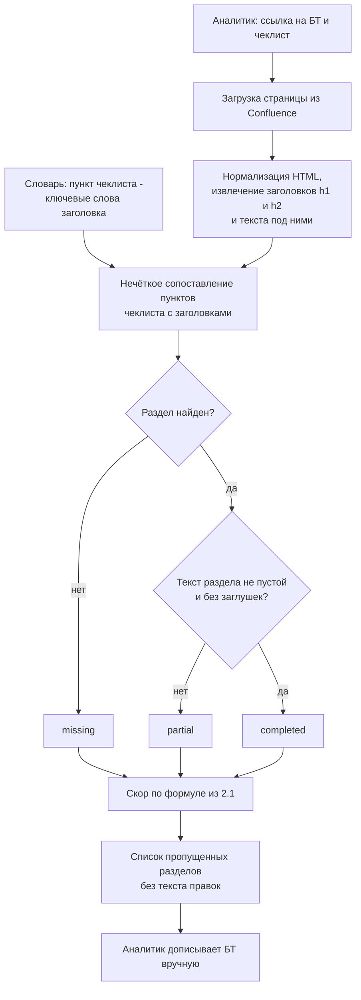
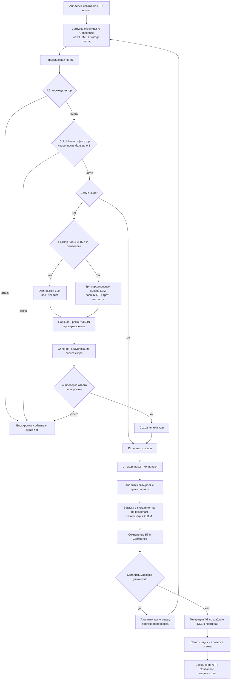
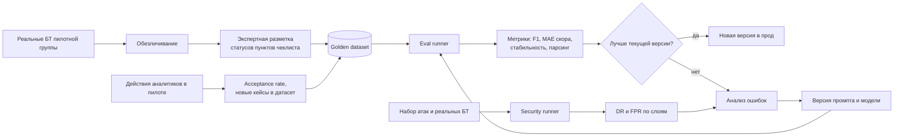
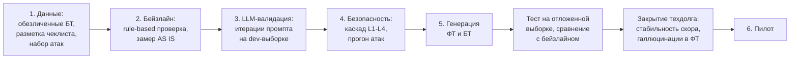
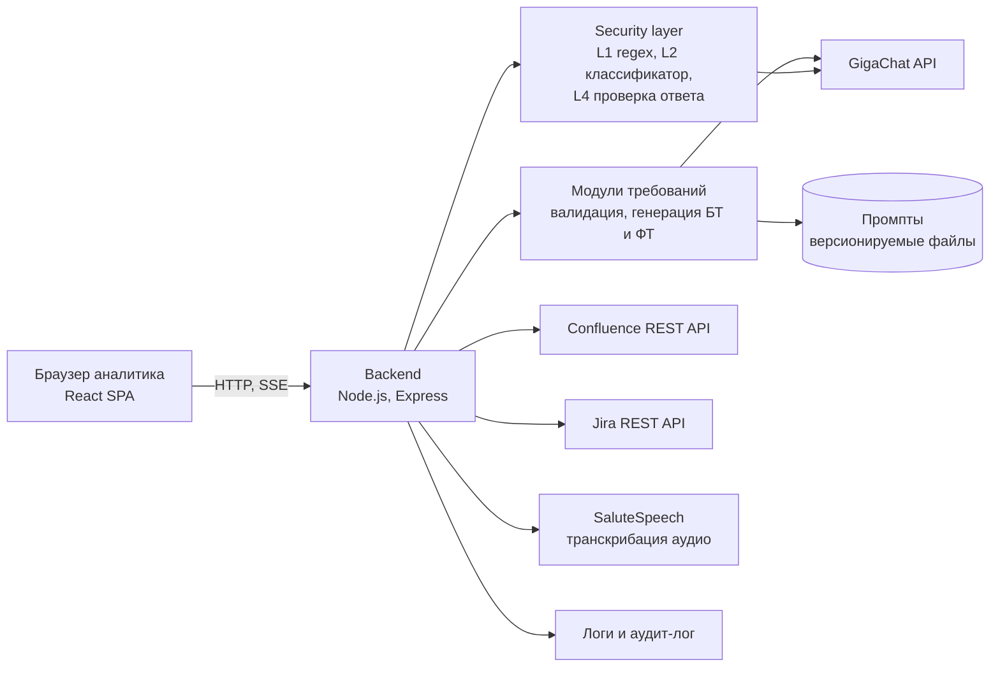

# Дизайн ML системы - ReqAssist MVP 1

ML System Design Doc LLM-ассистента системного аналитика, версия 1.0 (ДЗ 1).

Структура документа повторяет [шаблон Reliable ML](https://github.com/IrinaGoloshchapova/ml_system_design_doc_ru). Основной фокус ДЗ 1 - разделы 1 и 2; разделы 3 (пилот) и 4 (внедрение) заполнены на уровне MVP и будут детализироваться в следующих домашних заданиях.

> **О характере проекта.** ReqAssist - реальный внутренний продукт, который используется аналитиками в рабочем контуре. Название организации, внутренние адреса систем, номера задач, реальные документы и чеклисты не публикуются: в документе они заменены нейтральными формулировками и обобщёнными примерами. Замеры в разделе 2.1 взяты из внутренних прогонов и приведены без исходных данных.

## Глоссарий

| Термин | Значение |
| --- | --- |
| БТ | бизнес-требования: документ, в котором заказчик и аналитик описывают, что нужно изменить в продукте и зачем |
| ФТ | функциональные требования: документ для разработки и тестирования, детализирует БТ до уровня систем, данных и сценариев |
| Чеклист | список проверяемых критериев качества БТ (около 30 пунктов в 6 разделах), принятый в подразделении |
| Скор | оценка полноты БТ от 0 до 100 по чеклисту |
| Правка | предложение LLM дописать или расширить раздел БТ: заголовок, место вставки, текст-черновик |
| Storage format | XHTML-формат хранения страниц Confluence, в котором живут БТ и ФТ |
| `[уточнить: ...]` | маркер в тексте-черновике, который аналитик должен заполнить сам |

## 1. Цели и предпосылки

### 1.1. Зачем идем в разработку продукта?

#### Бизнес-цель

Сократить время аналитика на подготовку и согласование требований и снизить число дефектов требований, которые доходят до разработки.

Сейчас процесс выглядит так:

1. Аналитик проводит встречи с заказчиком и вручную собирает БТ в Confluence.
2. Перед согласованием БТ сверяются с чеклистом качества: ссылки на задачи, заинтересованные лица, источники и потребители данных, классы критичности, процессы AS IS и TO BE, интеграции, критерии приёмки, тестовые сценарии.
3. По согласованным БТ аналитик пишет ФТ по шаблону подразделения и заводит задачи в Jira.

Узкие места:

- проверка по чеклисту делается вручную и неравномерно: разные аналитики пропускают разные пункты
- пропуски находятся поздно, на ревью ФТ или в тестировании, когда исправление дороже
- перенос БТ в шаблон ФТ - механическая работа, которая занимает заметную часть времени аналитика
- в больших БТ (десятки тысяч символов, много таблиц) человеку трудно держать в голове весь документ

#### Почему ML (LLM) сделает лучше

Критерии чеклиста семантические: "описаны интеграции: названия систем, протоколы, SLA", "описаны тестовые сценарии с граничными случаями". Наличие нужного заголовка ничего не гарантирует: раздел может быть пустым, заполненным заглушкой или содержать нужную информацию под другим названием. Правила и регулярные выражения такие критерии не проверяют.

LLM позволяет:

- оценить каждый пункт чеклиста по смыслу текста, а не по структуре документа
- сразу сгенерировать черновик недостающего раздела на основе данных из самого документа
- перенести содержимое БТ в структуру шаблона ФТ с сохранением заголовков и таблиц
- извлечь требования из длинной расшифровки встречи

Аналитик остаётся владельцем документа: система предлагает, человек принимает решение.

#### Что считаем успехом итерации с точки зрения бизнеса

- аналитики пилотной группы используют валидацию БТ перед отправкой на согласование как штатный шаг
- время проверки одного БТ по чеклисту сокращается не менее чем на 30% относительно замера AS IS
- доля предложенных правок, которые аналитик принял (целиком или с доработкой), не ниже 50%
- скор на одном и том же документе стабилен: повторный запуск не меняет его больше чем на 5 пунктов
- ни одного инцидента с утечкой данных или выполнением внедрённых в документ инструкций

Целевые значения - гипотезы. Они уточняются после замера AS IS на пилоте (раздел 3).

### 1.2. Бизнес-требования и ограничения

#### Бизнес-требования

Детальные БТ к продукту ведутся во внутреннем Confluence и не публикуются; ниже сведены ключевые требования.

| № | Требование |
| --- | --- |
| БТ-1 | Загрузка БТ по ссылке на страницу Confluence без копирования текста вручную |
| БТ-2 | Проверка БТ по стандартному чеклисту подразделения или по собственному чеклисту аналитика (`.md`/`.txt`) |
| БТ-3 | Результат проверки: общий скор, статус каждого пункта чеклиста, список правок с приоритетом и местом вставки |
| БТ-4 | Применение выбранных правок в один клик с сохранением страницы в Confluence; макросы Confluence (Jira, оглавление) не ломаются |
| БТ-5 | Повторная проверка после доработки: уже применённые правки не предлагаются заново, скор не падает без изменения содержания |
| БТ-6 | Генерация ФТ по проверенным БТ в стандартном шаблоне или в шаблоне со страницы Confluence; сохранение ФТ дочерней страницей |
| БТ-7 | Создание задач в Jira со ссылками на страницы БТ и ФТ |
| БТ-8 | Генерация черновика БТ из расшифровки встречи (текст или аудио) |
| БТ-9 | Защита от prompt injection в загружаемых документах и чеклистах |

#### Бизнес-ограничения

- **Конфиденциальность.** БТ содержат внутреннюю информацию о продуктах и системах. Обрабатывать документы можно только моделью, разрешённой во внутреннем контуре (GigaChat). Внешние LLM-API недоступны.
- **Нет обучения своей модели.** Нет размеченного датасета и GPU-инфраструктуры под fine-tuning; в этой итерации работаем с LLM через API (промпты и structured output).
- **Контекстное окно.** Входы больше примерно 80 тыс. символов (БТ + шаблон + системный промпт) дают некорректный ответ модели. Нужны нормализация HTML, разбиение на части и параллельная обработка.
- **Латентность.** Генерация ответа валидации - около 60 секунд на один вызов. Ingress кластера рвёт соединения без активности дольше 60 секунд, поэтому длинные операции идут через SSE с heartbeat.
- **Строгий формат Confluence.** Сохраняемый текст должен быть валидным XHTML, иначе Confluence отклоняет запрос.
- **Человек в контуре.** Система не публикует изменения без подтверждения аналитика. Ответственность за содержание требований остаётся на аналитике.
- **Стоимость.** Каждый вызов LLM расходует токены из квоты; повторные вызовы на тех же данных нужно кэшировать.

#### Что ожидаем от итерации

- рабочий сценарий валидации БТ и генерации ФТ на реальных документах пилотной группы
- golden dataset с экспертной разметкой статусов пунктов чеклиста для офлайн-оценки
- воспроизводимая офлайн-оценка качества (скрипт + датасет + версия промпта)
- замер AS IS и TO BE по времени подготовки БТ/ФТ

#### Бизнес-процесс пилота

1. Аналитик открывает ReqAssist и вставляет ссылку на страницу БТ в Confluence.
2. Выбирает стандартный чеклист или загружает свой.
3. Получает скор, покрытие чеклиста и список правок. Отмечает нужные правки, при необходимости редактирует текст.
4. Сохраняет БТ в Confluence. Заполняет маркеры `[уточнить: ...]` и запускает повторную проверку.
5. По готовым БТ генерирует ФТ, проверяет и сохраняет их в Confluence, создаёт задачи в Jira.
6. Отмечает полезность каждой правки (принята, принята с доработкой, отклонена) - это источник онлайн-метрик.

#### Критерии успешного пилота и пути развития

Пилот успешен, если выполнены критерии из 1.1 и аналитики пилотной группы готовы продолжить использование. Дальнейшие шаги:

- расширение на другие подразделения со своими чеклистами
- офлайн-сравнение нескольких моделей и версий промптов на golden dataset
- дообучение или выбор специализированной модели, когда накопится размеченный датасет
- генерация тест-кейсов по ФТ

### 1.3. Что входит в скоуп проекта/итерации, что не входит

#### Входит в итерацию

| Блок | Что делаем | Закрывает БТ |
| --- | --- | --- |
| Валидация БТ | статус каждого пункта чеклиста, скор, правки с местом вставки | БТ-1, БТ-2, БТ-3 |
| Применение правок | вставка правок в storage format по названию раздела, санитизация XHTML, сохранение в Confluence | БТ-4 |
| Стабильность | кэш результатов, передача истории применённых правок, учёт заглушек `[уточнить]` в скоре | БТ-5 |
| Генерация ФТ | генерация по шаблону, SSE-стриминг, сохранение в Confluence, задачи в Jira | БТ-6, БТ-7 |
| Безопасность | каскад детекторов prompt injection, проверка ответа модели | БТ-9 |
| Оценка качества | golden dataset, офлайн-скрипт оценки, метрики из раздела 2.1 | - |

#### Не входит в итерацию

- генерация БТ из аудио под диктовку в браузере (БТ-8 закрывается только для текстовых расшифровок и загруженных аудиофайлов)
- fine-tuning и обучение собственных моделей
- поддержка источников, кроме Confluence (Word-файлы, другие вики)
- автоматическая публикация БТ и ФТ без подтверждения аналитиком
- генерация кода и тест-кейсов по ФТ

#### Качество кода и воспроизводимость

- промпты хранятся в репозитории как версионируемые файлы; изменение промпта - отдельный коммит с результатом офлайн-оценки
- офлайн-оценка запускается одной командой на фиксированном golden dataset
- параметры генерации фиксированы (низкая temperature), ответы модели в формате JSON с явной схемой
- unit-тесты на парсинг ответа, разбиение и слияние чеклиста, расчёт скора; интеграционные тесты на endpoint-ы
- линтеры и pre-commit в репозитории

#### Планируемый технический долг

- нет эталонной экспертной разметки: качество валидации сейчас оценивается на небольшом наборе кейсов с диапазонами допустимого скора
- скор всё ещё может меняться между запусками без изменения документа (стабилизирован кэшем, но не самой моделью)
- генерация ФТ: неполные ФТ по сравнению с шаблоном, модель иногда придумывает таблицы БД, которых нет в БТ
- генерация БТ из длинных расшифровок теряет часть требований
- известные обходы защиты: homoglyph-подмена символов, художественный фрейм, продолжение промпта

### 1.4. Предпосылки решения

#### Данные

| Источник | Формат | Объём одного объекта | Использование |
| --- | --- | --- | --- |
| Страницы БТ в Confluence | XHTML storage format и view HTML; разделы верхнего уровня `h1`, подразделы `h2`, таблицы, списки, макросы | от нескольких тысяч до 70+ тыс. символов | вход валидации и генерации ФТ |
| Чеклист | markdown, около 30 пунктов с нумерацией `X.Y` в 6 разделах | 2-5 тыс. символов | критерии валидации |
| Шаблоны ФТ | страница Confluence или встроенный шаблон | 15-35 тыс. символов | структура ФТ |
| Расшифровки встреч | текст или аудио (транскрибация через SaluteSpeech) | до 50+ тыс. символов | вход генерации БТ |
| Действия аналитика | события UI: принятые и отклонённые правки, повторные проверки | - | онлайн-метрики, будущая разметка |

#### Общие предпосылки

- **Гранулярность.** Один запрос - один документ. Результат валидации - на уровне пункта чеклиста.
- **Модель.** LLM как сервис (GigaChat) без обучения. Качество управляется промптами, схемой ответа и детерминированным пост-процессингом.
- **Почему не классический ML.** Нет размеченных данных для обучения классификатора по каждому пункту чеклиста, а сами пункты меняются от подразделения к подразделению (пользовательские чеклисты). Zero-shot LLM переносится на новый чеклист без переобучения.
- **Длинные документы.** БТ больше 15 тыс. символов проверяются тремя параллельными вызовами, каждый получает полный документ и свою треть чеклиста; результаты сливаются с дедупликацией. Расшифровки больше 40 тыс. символов режутся на части по 20 тыс., факты извлекаются параллельно и собираются в итоговый БТ.
- **Нормализация HTML.** Перед отправкой в модель из HTML убираются стили, `span`, `colgroup` и пустые элементы. Это сокращает шаблон примерно в 2 раза без потери структуры.
- **Внешние документы.** Модель оценивает только текст, переданный в запросе. Содержимое задач Jira и CR, на которые ссылается БТ, не додумывается.
- **Человек в контуре.** Каждая правка проходит через аналитика, поэтому ошибка модели стоит времени аналитика, а не попадает сразу в документ.

## 2. Методология

### 2.1. Постановка задачи

Система решает четыре задачи. Основная в этой итерации - задача A.

#### Задача A. Валидация БТ по чеклисту

Вход: документ $d$ (HTML), чеклист $C = \{c_1, \dots, c_n\}$, история ранее применённых правок $H$ (может быть пустой).

Выход:

1. Статус каждого пункта $s_i \in \{\text{completed}, \text{partial}, \text{partial\_placeholder}, \text{missing}, \text{not\_applicable}\}$.
2. Скор полноты:

   $$\text{score} = \text{round}\left(\frac{1.0 \cdot |C_{\text{completed}}| + 0.5 \cdot |C_{\text{partial}}| + 0.1 \cdot |C_{\text{placeholder}}|}{n - |C_{\text{n/a}}|} \cdot 100\right)$$

3. Список правок: категория, заголовок, описание, приоритет (critical, high, medium, low), раздел для вставки, тип действия (`add_section`, `extend_section`, `add_content`), черновик текста, признак независимости от других правок.

Тип задачи: многоклассовая классификация каждого пункта чеклиста (zero-shot через LLM) плюс условная генерация текста правок. Ответ модели - JSON по фиксированной схеме.

Baseline:

- ручная проверка аналитиком (AS IS)
- rule-based: пункт считается выполненным, если в документе есть раздел с похожим заголовком и непустым содержимым

#### Задача B. Генерация ФТ по БТ

Вход: проверенные БТ, шаблон ФТ, дополнительные инструкции аналитика. Выход: документ ФТ в HTML, совместимый с Confluence.

Тип задачи: условная генерация текста с ограничениями: сохранить все заголовки и нумерацию шаблона, заполнить их только данными из БТ, не переносить содержимое старого шаблона, не придумывать системы и таблицы, которых нет в БТ.

#### Задача C. Генерация БТ из расшифровки

Вход: расшифровка встречи. Выход: черновик БТ по стандартной структуре с маркерами `[уточнить: ...]` там, где данных не хватило.

Тип задачи: извлечение информации и абстрактивная суммаризация длинного текста.

#### Задача D. Детекция prompt injection

Вход: текст документа или чеклиста. Выход: бинарная метка "атака / не атака" и уверенность.

Тип задачи: бинарная классификация, каскад детекторов:

| Слой | Метод | Назначение |
| --- | --- | --- |
| L1 | регулярные выражения | дешёвая мгновенная блокировка известных шаблонов атак |
| L2 | LLM-классификатор, порог уверенности 0.8 | семантические и обфусцированные атаки |
| L3 | ограничение домена основного агента | агент возвращает только результат проверки БТ, даже если атака прошла |
| L4 | проверка ответа модели и canary-токен | обнаружение утечки системного промпта |

#### Метрики

Офлайн (golden dataset, экспертная разметка):

| Задача | Метрика | Как считаем | Цель итерации |
| --- | --- | --- | --- |
| A | macro-F1 статусов пунктов | сравнение статусов модели с разметкой эксперта | не ниже 0.7 |
| A | MAE скора | средняя абсолютная разница скора модели и эксперта | не больше 10 пунктов |
| A | стабильность скора | стандартное отклонение скора на 5 повторных запусках одного документа | не больше 5 пунктов |
| A | доля непарсящихся ответов | ответы, которые не удалось разобрать как JSON по схеме | меньше 2% |
| B | полнота по шаблону | доля разделов шаблона, заполненных содержательным текстом | не ниже 90% |
| B | доля галлюцинаций | доля упомянутых в ФТ систем и таблиц, которых нет в БТ | меньше 5% |
| C | recall требований | доля требований из эталонного списка, попавших в БТ | не ниже 80% |
| D | detection rate (DR) | доля заблокированных атак из набора payload-ов | не ниже 95% |
| D | false positive rate (FPR) | доля заблокированных реальных БТ | 0% |

Онлайн (пилот):

| Метрика | Определение |
| --- | --- |
| Acceptance rate | доля принятых правок от показанных |
| Время подготовки БТ и ФТ | от создания страницы до отправки на согласование, AS IS и TO BE |
| Число итераций ревью | сколько раз БТ возвращались на доработку до согласования |
| Латентность | p50 и p95 времени ответа валидации и генерации ФТ |

Текущие замеры:

- валидация одним вызовом - около 60 секунд, цель после распараллеливания - 20-25 секунд
- реальный БТ размером около 8 тыс. символов проходит валидацию вместе с защитным слоем за 32 секунды
- защита: на 15 атаках из базового набора DR = 100% (8 блокирует L1 за 0.3 секунды, 7 блокирует L2), FPR = 0% на 4 реальных документах; на расширенном наборе из 25 атак с обфускацией и обходами DR = 88%, FPR = 0% на 5 документах

### 2.2. Блок-схема решения

Бейзлайн и MVP отличаются принципиально (правила по структуре документа против LLM по смыслу текста), поэтому схемы две. Отдельно показаны офлайн-контур оценки и этапы работ.

#### Бейзлайн: rule-based проверка структуры

Бейзлайн дешёвый и детерминированный, но не видит смысла: пустой по существу раздел с подходящим заголовком засчитывается, а нужная информация под другим заголовком - нет. Он нужен как нижняя граница для метрик задачи A.

#### MVP: онлайн-контур

#### Офлайн-контур оценки и улучшения

#### Этапы работ до пилота

### 2.3. Этапы решения

Роли: PO - владелец продукта, DS - ML-инженер, отвечающий за промпты и оценку, эксперт - ведущий аналитик, ИБ - специалист по информационной безопасности.

#### Этап 1. Подготовка данных

Модель не обучается, поэтому "признаки" - это входы промпта, а целевые переменные нужны для оценки качества и сравнения версий.

Целевые переменные:

| Название данных | Есть ли в компании | Требуемый ресурс | Качество проверено |
| --- | --- | --- | --- |
| Статус пункта чеклиста для документа (5 классов) | нет, размечается в рамках этапа | эксперты, DS | нет, проверяется через согласие разметчиков |
| Экспертный скор документа | нет, считается из разметки по формуле 2.1 | DS | производная от разметки |
| Эталонные ФТ | да, согласованные ФТ в Confluence | эксперт | да, прошли ревью разработки |
| Эталонный список требований по расшифровке | нет, составляется по согласованному БТ | эксперт | нет |
| Метка "атака / не атака" | да, собственный набор payload-ов | DS, ИБ | да, проверен вручную |
| Решение аналитика по правке (принята, с доработкой, отклонена) | частично, события UI и endpoint обратной связи | DS | нет, появится в пилоте |

Входные данные (аналог признаков):

| Название данных | Есть ли в компании | Требуемый ресурс | Качество проверено |
| --- | --- | --- | --- |
| Текст БТ (view HTML и storage format) | да, Confluence | доступ аналитика к пространствам | да |
| Стандартный чеклист | да, файл в репозитории продукта | эксперт | да |
| Пользовательские чеклисты | да, у отдельных аналитиков | эксперт | нет, разный формат |
| Шаблоны ФТ | да, Confluence | эксперт | да |
| Расшифровки встреч | частично, записи встреч | аналитик, SaluteSpeech | нет |
| История применённых правок | да, состояние сессии в UI | - | да |

Формирование выборок: golden dataset делится на dev-выборку (около 2/3 документов) для итераций промпта и отложенную test-выборку, которая используется только для финального сравнения версий и бейзлайна. Деление стратифицируется по размеру документа (до и больше 15 тыс. символов) и по типу БТ, чтобы промпт не подгонялся под конкретные документы. Набор атак делится так же.

Сущности и требования к качеству:

| Сущность | Источник | Роли | Проверка качества |
| --- | --- | --- | --- |
| Документы БТ | страницы Confluence пилотной группы, обезличенные | эксперт, DS | валидный HTML, есть разделы верхнего уровня, размер после нормализации помещается в контекст |
| Разметка статусов пунктов чеклиста | 2 эксперта независимо размечают 30-50 БТ | эксперт, DS | согласие разметчиков (Cohen's kappa не ниже 0.6), спорные пункты разбирает третий эксперт |
| Эталонные ФТ | согласованные ФТ по тем же БТ | эксперт | ФТ прошли ревью разработки, есть связь с исходным БТ |
| Расшифровки и эталонный список требований | записи встреч пилотной группы | эксперт | список требований составлен по итоговому согласованному БТ |
| Набор атак prompt injection | собственный набор: точные, семантические, обфусцированные атаки и обходы; реальные БТ как негативы | DS, ИБ | каждый payload проверен вручную, для каждого указан ожидаемый результат |

Результат этапа: версионированный golden dataset, который не меняется между сравниваемыми версиями промптов.

#### Этап 2. Бейзлайн

- Техника: rule-based проверка по схеме из 2.2. Пункт чеклиста сопоставляется с заголовками документа по словарю ключевых слов; найден раздел с непустым текстом - completed, раздел с заглушкой - partial, раздела нет - missing.
- Выборка: вся golden dataset, обучения нет.
- Метрики: те же, что для MVP (macro-F1 статусов, MAE скора). Целевых значений для бейзлайна нет: он задаёт нижнюю границу, ожидаемо слабую на пунктах про содержание (тестовые сценарии, классы критичности).
- Замер AS IS: время ручной проверки БТ по чеклисту и подготовки ФТ на выборке документов пилотной группы.
- Результат: точка отсчёта для офлайн-метрик задачи A и бизнес-метрик пилота.
- Бизнес-проверка: эксперт просматривает 10 документов с наибольшим расхождением бейзлайна и своей разметки и подтверждает, что ошибки связаны со смыслом текста, а не с ошибками разметки.

#### Этап 3. LLM-валидация БТ (задача A)

- Техника MVP: zero-shot LLM с системным промптом, схемой JSON-ответа и правилами оценки; ремонт и проверка JSON; разбиение чеклиста на 3 части для документов больше 15 тыс. символов; слияние и дедупликация; кэш.
- Почему LLM, а не обученный классификатор: пункты чеклиста меняются между подразделениями, размеченных данных нет, а LLM переносится на новый чеклист без обучения. Fine-tuning рассматривается после накопления разметки из пилота.
- Целевая переменная: статус каждого пункта чеклиста из пяти классов, производная - скор. Классы и веса скора согласованы с экспертами.
- Гранулярность и пересчёт: результат считается на каждый запрос для пары документ-чеклист; офлайн-оценка пересчитывается при каждом изменении промпта, версии модели или логики пост-процессинга.
- Выборки: итерации промпта идут только на dev-выборке, итоговое сравнение с бейзлайном и предыдущей версией - на test-выборке.
- Метрики и связь с бизнесом: macro-F1 статусов и MAE скора отвечают за доверие аналитика к оценке (бизнес-цель из 1.1), стабильность скора - за то, что повторная проверка после доработки показывает реальный прогресс (БТ-5), доля непарсящихся ответов - за отказы, которые видит пользователь. Цель: macro-F1 не ниже 0.7 и выше бейзлайна не меньше чем на 0.15.
- Необходимый результат этапа: метрики на test-выборке на уровне целей из 2.1 и отсутствие деградации на документах больше 15 тыс. символов по сравнению с короткими.
- Риски и что делаем: модель додумывает содержимое внешних документов - правило в промпте и тест-кейсы со ссылками на задачи; оценивает заглушки как заполненные разделы - отдельный статус partial_placeholder с весом 0.1; скор меняется между запусками - кэш, низкая temperature, метрика стабильности.
- Бизнес-проверка: эксперт разбирает все ошибки модели на test-выборке и помечает, какие из них критичны для аналитика (пропущенный missing важнее лишнего partial).
- Роли: DS ведёт итерации, эксперт разбирает ошибки модели.

#### Этап 4. Безопасность (задача D)

- Каскад L1-L4, прогон набора атак после каждого изменения промптов и детекторов.
- Метрики: DR по слоям и суммарно, FPR на реальных БТ, латентность L1 и L2.
- Риски: LLM-классификатор L2 уязвим к тем же атакам, которые детектирует (ответ не парсится); обфускация через похожие символы обходит L1.
- Роли: DS, ИБ.

#### Этап 5. Генерация ФТ и БТ (задачи B и C)

- Целевая переменная: текст документа; оценка - через полноту по шаблону, долю галлюцинаций и recall требований.
- Риски: неполные ФТ, вымышленные таблицы БД, потеря требований в длинных расшифровках.
- Роли: DS, эксперт проверяет выборку сгенерированных документов.

#### Этап 6. Пилот

- Запуск на пилотной группе, сбор онлайн-метрик и обратной связи по правкам (раздел 3).
- Результат: решение PO о масштабировании на другие подразделения.

## 3. Подготовка пилота

### 3.1. Способ оценки пилота

- Пилотная группа: 5-10 аналитиков одного подразделения, длительность 4 недели. Контроль: те же аналитики за 4 недели до пилота (AS IS) или соседняя группа без инструмента.
- Время подготовки БТ и ФТ считается по истории версий страниц Confluence: от создания страницы до перевода задачи на согласование в Jira.
- Число итераций ревью - по переходам статусов задачи в Jira.
- Acceptance rate - по событиям UI: показанные, принятые, принятые с правкой и отклонённые правки.
- Перед стартом пилота текущая версия промптов должна пройти офлайн-оценку на golden dataset на уровне целей из раздела 2.1.

### 3.2. Что считаем успешным пилотом

Пилот успешен, если выполнены бизнес-критерии из раздела 1.1, офлайн-метрики не деградировали за время пилота и не было инцидентов безопасности. Точные пороги согласуются с PO после замера AS IS, до запуска пилота.

### 3.3. Подготовка пилота

- **Вычислительная сложность.** Валидация - 1 вызов LLM для документов до 15 тыс. символов и 3 параллельных вызова для больших; плюс 1 вызов L2-классификатора. Генерация ФТ - 1-2 вызова, около 60-70 секунд. Генерация БТ из длинной расшифровки - до 3 параллельных вызовов на части плюс итоговая сборка.
- **Ограничения.** Квота токенов LLM на пилотную группу, лимит 100 запросов в минуту на клиента, не больше 3 одновременных вызовов LLM на одну операцию.
- **Сокращение нагрузки.** Кэш результатов валидации в браузере (24 часа, до 20 записей), повторная проверка без изменения документа не вызывает модель.
- **Сбор обратной связи.** Отметка полезности правки в UI отправляется на endpoint обратной связи.

## 4. Внедрение

### 4.1. Архитектура решения

- Backend без состояния: документы не хранятся на сервере, состояние сессии живёт в браузере.
- Промпты загружаются из файлов и кэшируются в памяти при старте сервера.
- Ответ модели проходит парсинг, ремонт JSON и проверку схемы до того, как попасть к пользователю.

### 4.2. Описание инфраструктуры и масштабируемости

- Docker-образ с двухстадийной сборкой: в финальном образе только runtime, без npm.
- Развёртывание в Kubernetes через Helm-чарты; backend масштабируется горизонтально, так как не хранит состояние.
- Узкое место - время генерации токенов и квота LLM, а не CPU сервиса. Масштабирование упирается в квоту, поэтому важны кэш и разбиение на параллельные вызовы.
- Ingress обрывает соединения без активности дольше 60 секунд, поэтому длинные операции идут через SSE с heartbeat каждые 15 секунд.

### 4.3. Требования к работе системы

| Требование | Значение |
| --- | --- |
| Режим работы | рабочие часы аналитиков, интерактивные запросы |
| Латентность валидации | p95 не больше 60 секунд, цель после распараллеливания - 25 секунд |
| Латентность генерации ФТ | p95 не больше 120 секунд с прогрессом через SSE |
| Отказоустойчивость | 3 повтора с экспоненциальной задержкой и jitter на ошибки 429, 503 и обрыв соединения |
| Ошибки модели | непарсящийся ответ возвращается как явная ошибка 502, а не как пустой результат |

### 4.4. Безопасность системы

- Доступ к Confluence и Jira - с токеном пользователя: система действует с правами аналитика и не видит чужих страниц.
- Rate limiting на все API, фильтр загружаемых файлов (только `.md`, `.txt`, `.html`).
- Каскад защиты от prompt injection (раздел 2.1, задача D), режим мониторинга или блокировки.
- Секреты хранятся в секретах Kubernetes, в репозиторий не попадают.
- Минимальный runtime-образ: без пакетного менеджера и лишних утилит.

### 4.5. Безопасность данных

- Документы обрабатываются моделью только внутри корпоративного контура.
- В логи не пишется содержимое документов; отладочные фрагменты ответа модели обрезаются до 1000 символов.
- Golden dataset собирается только из обезличенных документов, доступ к нему ограничен командой проекта.

### 4.6. Издержки

- Основная статья - токены LLM. Стоимость операции: сумма входных и выходных токенов по всем вызовам, умноженная на тариф. Для валидации большого документа вход умножается на 3 (полный БТ в каждом из параллельных вызовов) плюс вызов L2-классификатора.
- Кэш результатов и нормализация HTML снижают расход токенов; эффект измеряется по логам на пилоте.
- Инфраструктура сервиса - один-два пода без GPU, издержки на неё малы по сравнению с LLM.

### 4.7. Integration points

| Endpoint | Назначение |
| --- | --- |
| `POST /api/validate-requirements` | валидация БТ по чеклисту |
| `POST /api/generate-business-requirements`, `POST /api/generate-br/stream` | генерация БТ из расшифровки |
| `POST /api/generate-ft/stream` | генерация ФТ, SSE |
| `POST /api/confluence/load`, `POST /api/confluence/create`, `PUT /api/confluence/update` | чтение и сохранение страниц |
| `POST /api/jira/create-issue-from-ft` | создание задач по ФТ |
| `POST /api/audio/transcribe` | транскрибация аудио |
| `POST /api/feedback` | обратная связь по правкам |
| `POST /api/v1/tools/validate`, `/generate-br`, `/generate-ft` | API для других агентов и автоматизаций с метриками безопасности в ответе |

### 4.8. Риски

| Риск | Влияние | Митигация |
| --- | --- | --- |
| Нестабильность скора между запусками | аналитик перестаёт доверять оценке | кэш, низкая temperature, история правок в запросе, метрика стабильности в офлайн-оценке |
| Галлюцинации в правках и ФТ | ошибочные требования попадают в документ | только данные из БТ, маркеры `[уточнить]`, обязательное подтверждение аналитиком |
| Превышение контекстного окна | некорректный ответ на больших документах | нормализация HTML, разбиение чеклиста, чанкинг расшифровок |
| Prompt injection через документ | утечка системного промпта, некорректный результат | каскад L1-L4, регулярный прогон набора атак |
| Мало данных для разметки | слабая офлайн-оценка | разметка в пилоте, пополнение датасета из отклонённых правок |
| Изменение модели на стороне провайдера | деградация качества без изменений в коде | фиксация версии модели, регулярный прогон офлайн-оценки |
